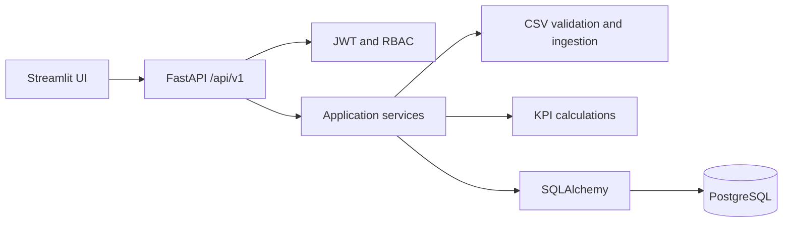

# Architecture

PortfolioPulse is a modular monolith. FastAPI exposes versioned HTTP routes; dependencies resolve the authenticated user and SQLAlchemy session; services process uploads and compute portfolio data; PostgreSQL stores tenant-scoped records. Streamlit is a separate HTTP client and never connects to the database.

Request flow: UI/client -> Fastapi route -> authentication/permission dependency -> scoped query/service -> database -> response schema. Upload flow: byte limit and extension -> UTF-8 CSV parse -> schema and row validation -> tenant company/period resolution -> duplicate checks -> transaction -> submission and processing logs.

Reporting configuration is organisation-owned and versioned: a reporting period binds to one template version, and later template revisions do not reinterpret historical periods. Ingestion stages metrics under a submission; an explicit review and admin decision precede analytics inclusion. Submission state changes create both a timeline event and an audit record. PostgreSQL composite foreign keys enforce organisation consistency between linked users, companies, periods, templates, submissions, metrics, and events.
