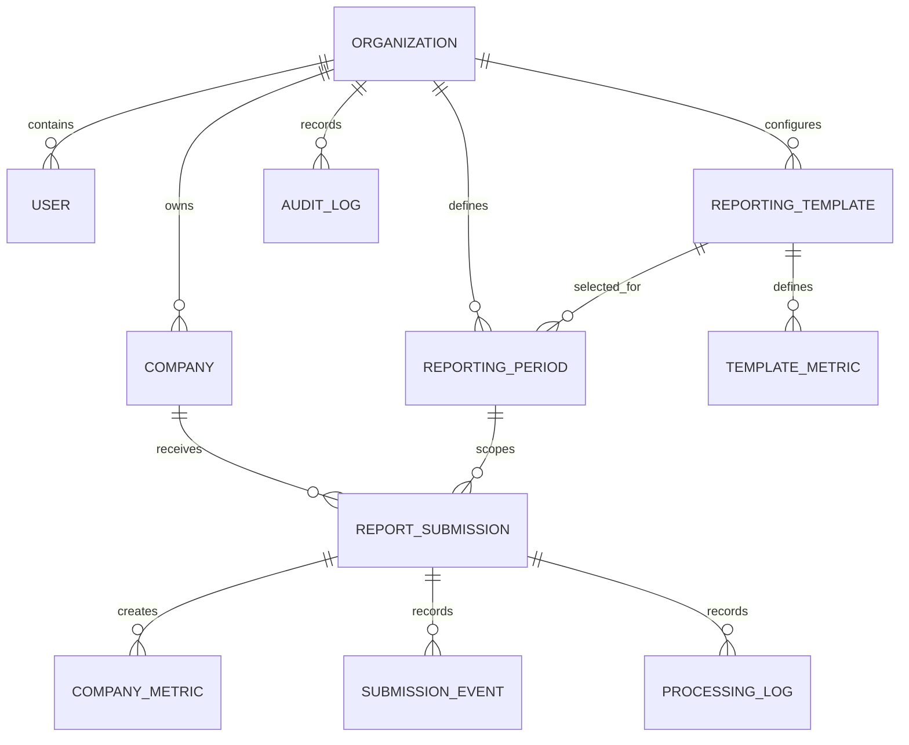

# Database design

Entities include Organization, User, Company, ReportingTemplate, TemplateMetric, ReportingPeriod, ReportSubmission, SubmissionEvent, CompanyMetric, ProcessingLog and AuditLog. Tenant-owned tables carry `organization_id`; PostgreSQL composite foreign keys bind users, companies, periods, templates, submissions, metrics, and events to the same organisation. A period references a specific immutable template version. Company metrics are staged per submission; an approved-submission partial unique index enforces one current approved report per company/period. Metric columns allow `NULL` for optional template metrics, with non-negative checks where values are present.

UUID strings are used as portable identifiers. Monetary values use `NUMERIC(18,2)`. Timestamps are UTC-aware at the application boundary. Alembic owns schema lifecycle.
